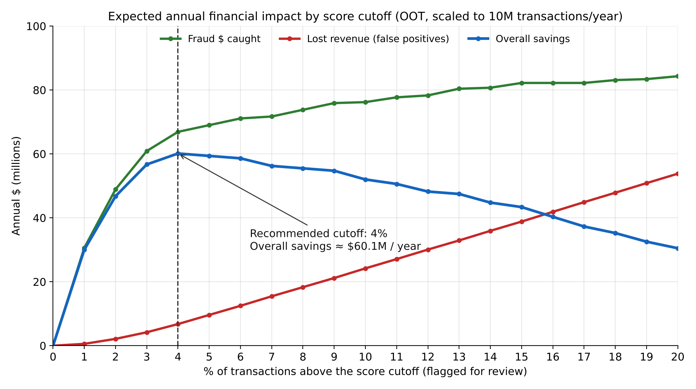
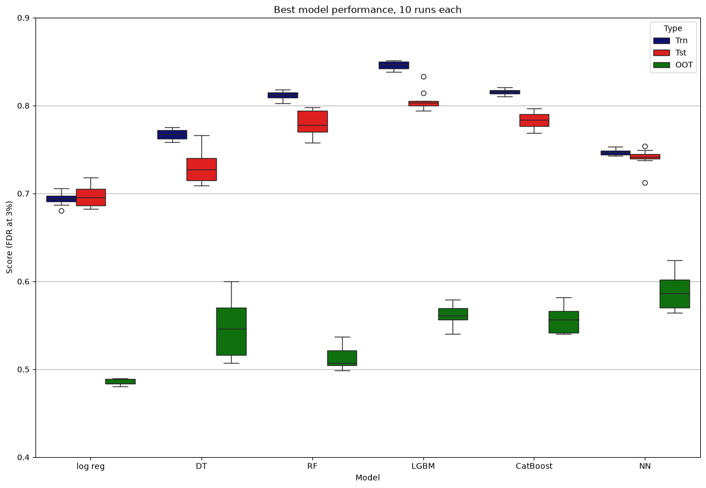

# Credit Card Transaction Fraud Detection

A supervised machine learning model that scores credit card purchases by fraud risk, built end to end: data quality review, cleaning, feature engineering, feature selection, model tuning, out-of-time validation, and a business recommendation for the score cutoff.

**Headline result:** on two months of held-out, out-of-time data, flagging the riskiest **3%** of transactions catches **60.6%** of all fraud. At the recommended **4%** cutoff, the model is expected to save about **$60 million per year** for a portfolio of 10 million transactions.



---

## Problem

Every fraudulent purchase that goes through is a direct loss, and every legitimate purchase that is wrongly stopped costs revenue and customer goodwill. The goal is a score that ranks each transaction by how likely it is to be fraud, so the riskiest ones can be stopped or reviewed in real time.

## Data

- About 98,000 credit card purchase transactions made by employees of a U.S. government organization during 2010
- 10 fields: record number, card number, date, merchant number, merchant description, merchant state, merchant zip, transaction type, amount, fraud label
- 2,283 labeled frauds (2.33%)

> The data set was provided for coursework and is **not included** in this repository.

## Approach

| Step | What was done |
|---|---|
| **Data quality report** | Profiled every field (population, unique values, distributions). Found a $2,500 single-purchase limit, a $3.1M outlier, FedEx micro-charges, and corrupted state codes. |
| **Cleaning** | Kept purchase transactions only (−355 records) and removed one $3.1M outlier. Imputed missing merchant number, state and zip from related fields in the same record. 97,805 records remain, with no frauds lost. |
| **Feature engineering** | Built about 3,350 candidate variables over 23 entities (card, merchant, card × merchant, card × zip, card × state, card × day of week, …) and look-back windows of 0–60 days. They cover velocity, amount statistics, actual-vs-typical ratios, days since last use, unique-count variables, relative velocity, Benford's law and target encoding. I added 19 variables (split purchases to avoid the $2,500 limit, repeated identical amounts, amount z-score vs. the card's own history, card–merchant loyalty) and fixed 7 variables that had index or data-type bugs. 2,663 variables remain after removing duplicates. |
| **Feature selection** | Univariate KS filter → top 1,000 → forward sequential selection with an LGBM wrapper scored by FDR@3% (2-fold CV) → 20 variables. Performance saturates at about 10 variables. Nine wrapper configurations were compared. |
| **Model exploration** | Logistic regression (baseline), decision tree, random forest, LightGBM, CatBoost and a neural network. Each hyperparameter setting was averaged over 10 random 70/30 train/test splits and checked against out-of-time data. |
| **Final model** | Neural network (MLP): 1 hidden layer of 20 tanh units, alpha = 0.01, top 10 variables. It had the best out-of-time performance and almost no overfitting. |
| **Business analysis** | Turned out-of-time results into annual dollars ($500 saved per fraud caught, $40 lost per false positive, 10M transactions/year) and recommended a score cutoff. |

**Validation design:** January–October 2010 is used for training and testing (random 70/30 split). November–December 2010 is held out as **out-of-time (OOT)** data, the best estimate of performance after deployment.

## Results

### Model comparison (FDR@3%, mean of 10 runs)

| Model | Train | Test | OOT |
|---|---|---|---|
| Logistic regression | 0.694 | 0.697 | 0.485 |
| Decision tree | 0.767 | 0.735 | 0.554 |
| Random forest | 0.814 | 0.781 | 0.514 |
| LightGBM | 0.847 | 0.805 | 0.565 |
| CatBoost | 0.808 | 0.794 | 0.554 |
| **Neural network** | **0.749** | **0.746** | **0.600** |

The boosted trees score highest on test data but lose more on the later months. The neural network generalizes best to new data.



### Final model

| | Train | Test | OOT |
|---|---|---|---|
| FDR@3% | 74.9% | 74.6% | **60.6%** |

### Recommended cutoff

| Cutoff (% flagged) | Fraud caught | Goods flagged per fraud | Overall savings / year |
|---|---|---|---|
| 3% | 60.6% | 0.86 | $56.7M |
| **4%** | **66.6%** | **1.26** | **$60.1M** |
| 5% | 68.7% | 1.74 | $59.4M |

Savings peak at a 4% cutoff and then slowly decline as false positives grow faster than the extra fraud caught.

## Repository structure

```
├── README.md
├── report/
│   └── Fraud_Model_Project_Report.pdf   # full report
├── src/
│   └── final_model.py                   # final model + results tables + financials
└── figures/
    ├── financials.png
    ├── model_comparison.png
    └── feature_selection.png
```

## Reproducing

The data are not public, so the code cannot be run as is. With a file `vars_final.csv` (the 20 selected variables, `Recnum` and `Fraud`):

```bash
pip install pandas numpy scikit-learn matplotlib
python src/final_model.py <data_dir> search   # 40 runs with frozen hyperparameters
python src/final_model.py <data_dir> 25       # final run: writes FDR tables and annual financials
```

## Tools

Python · pandas · NumPy · scikit-learn · LightGBM · CatBoost · mlxtend · matplotlib

## Acknowledgments

Built as a project for Fraud Analysis at UCLA. The overall modeling pipeline follows a framework provided in the course; the data cleaning choices, the added and corrected variables, feature selection experiments, model tuning, final model and business analysis are my own work.
